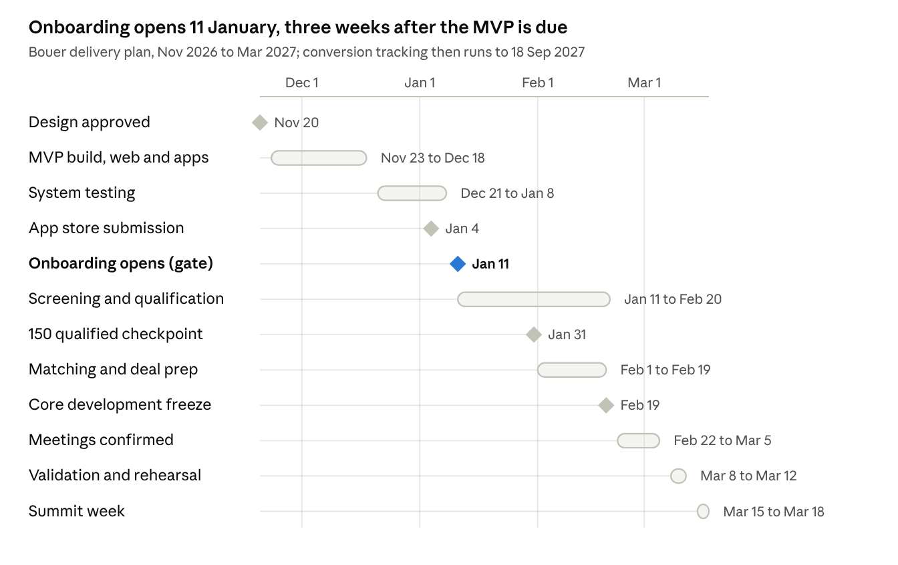

# ExcursiaConnect Deal Room — PRD

Nov 6, 2026 · David Muia

## Overview

The Deal Room is an ExcursiaConnect module, switched on per event, that connects capital seekers with investors and other finance providers before, during and for six months after a summit. It qualifies both sides against written criteria, matches them only when both are ready and have accepted an introduction, schedules timed meetings in Deal Room rooms, and tracks each opportunity to an evidenced outcome. It reuses ExcursiaConnect registration, roles, rooms, badges, notifications and reporting, and adds qualification, matching, consent tiers and a deal pipeline.

**Anchor client.** Bouer, for the Connected Africa 3.0 Deal Room (summit 15–18 March 2027). Bouer's requirements document is the v1 bar; items from it are tagged **[Bouer]**. The design follows the [AfCEN Deal Room](https://dealrooms.africacen.org/) model (evidence-linked scoring, tiered disclosure) and the Africa Investment Forum's Deal Tracker for post-event conversion. Background research: *04-Deal-Room-Research.md*.

**Problem.** Summit deal rooms today run on application forms, spreadsheets and email. Investors get unqualified meeting requests, confidential documents travel without a record, rooms double-book, and nobody can show six months later which meetings turned into money.

**Goals and planning targets [Bouer]**

| Outcome | Target | Deadline |
| --- | --- | --- |
| Qualified counterparties across three missions | 150 | 31 Jan 2027 |
| Deal Room Ready opportunities, both sides confirmed | 60 | 20 Feb 2027 |
| Booked Deal Room meetings | 200 | Summit week, 15–18 Mar 2027 |
| Post-summit conversion tracking, reviewed monthly | Every opportunity | To 18 Sep 2027 |

Product goals behind those targets:

- Every approval, readiness score and match decision is recorded with who made it, when, and the evidence it rests on.
- No meeting exists unless both parties accepted the introduction; no room or person is ever double-booked.
- No confidential document is opened without a recorded consent and an access log entry.
- Reports separate interest, promise, signed commitment and funds received, so conversion figures cannot be inflated.

**Non-goals (v1)**

- Automatic matching or introductions without a reviewer's approval.
- Running deal negotiation, term sheets or e-signature inside the platform.
- Holding or moving investment funds; the platform records evidence of funds received only.
- A public investment marketplace open to unverified investors.
- Deal Rooms outside a hosted event (an always-on deal-flow platform).

## Module activation and event setup

The Deal Room is enabled per event by the platform admin at event approval, priced as a rate-card add-on, and configured by the Deal Room lead before applications open.

**Requirements**

1. The platform admin switches the Deal Room on for an approved event and records the add-on price and any on-site Deal Room desk staffing on the event's approval record (extends ExcursiaConnect *Event setup and approval* req. 3).
2. The lead defines **missions** (for Bouer: three) and a **source taxonomy** (referral, partner, outreach campaign, inbound, mission team) **[Bouer]**. Every application and lead carries one mission, one source and one owner.
3. The lead defines **counterparty types**: capital seeker, and finance provider sub-types (investor, fund, DFI, bank, buyer/offtaker, distributor, project sponsor) **[Bouer]**.
4. The lead configures one **application form per counterparty type** using the ExcursiaConnect form builder (standard plus custom fields, file uploads up to 25 MB for Deal Room documents).
5. The lead configures one **qualification rubric per counterparty type** (see Qualification) and the **matching fields** both sides must complete.
6. The lead sets **dates and rules** (see Notifications, rules and deadlines): application window, profile deadline, meeting length, buffers, caps, request-to-confirm window **[Bouer UC-14]**.
7. The lead lists **Deal Room rooms and tables** for summit week, each with capacity and availability windows, as ExcursiaConnect rooms inside a Deal Room zone; online meetings are allowed per event setting.
8. The lead invites staff into three Deal Room roles: reviewer, operations, lead (see Stakeholders).
9. The public Deal Room page (eligibility, how it works, apply buttons, FAQ) is generated from the configuration and uses the organiser's branding; it is live only when the event is Live.
10. Configuration is locked for structural fields (rubric criteria, matching fields, missions) at the design freeze date the lead sets; later changes are logged and need lead approval.

## Applications

A public visitor can check eligibility and apply as a capital seeker or a finance provider; each submission gets a reference number, a status the applicant can see, and a place in the review queue **[Bouer UC-01, UC-02]**.

**Requirements**

1. The public page shows eligibility criteria per counterparty type and a short self-check before the form (sector, geography, stage, instrument sought or offered).
2. Applicants create an account with email or phone and a one-time code (ExcursiaConnect delegate pattern); a password is optional.
3. **Capital seeker form**: organisation (legal name, registration number, country, sector, year founded, website), funding ask (amount and currency, instrument: equity, debt, mezzanine, grant, trade finance, other; use of funds; stage), traction (revenue band, customers, key metrics), a named decision-maker (name, title, email, phone), mission and source, and documents (pitch deck, financials for the last two years where available, registration certificate, any feasibility or E&S studies).
4. **Finance provider form**: organisation and type, mandate (sectors, countries, stages, ticket range min and max, instruments, exclusions), named decision-maker, typical decision timeline, mission and source.
5. Forms save as drafts; a draft resumes on any channel (web, Android, iOS) from the server copy, so nothing typed is lost **[Bouer §8]**.
6. Submission is blocked until required fields and required documents are present; the form names each missing item **[Bouer UC-01]**. Incomplete mandate fields are flagged for correction rather than blocking where the lead marks them advisory **[Bouer UC-02]**.
7. On submit the system issues a reference number (e.g. `CA3-CS-00123`, `CA3-FP-00045`), confirms by email and SMS, and places the application in the review queue.
8. Applicants see a status page: Submitted, In review, Information requested, Decided, with the date of the last change and any open request.
9. **Bulk import**: the lead or a reviewer imports leads and pre-filled applications from CSV with mission, source and owner; each imported record gets an invitation link to complete and submit. This covers mobilisation that starts before onboarding opens.
10. Duplicate detection on organisation registration number, email and phone within the event, with a merge action for the lead.
11. One organisation can hold more than one application only if the lead allows multiple opportunities per organisation (a sponsor with two projects); each opportunity is its own record.

## Qualification, readiness and investor verification

Qualification is a scored rubric with evidence per criterion, and a capital seeker carries three independent states: application status, decision, and readiness. Finance providers are verified rather than scored. Only verified providers and Deal Room Ready seekers can be matched **[Bouer §2, 7A-C]**.

**Capital seeker rubric (configurable per event; default below)**

| Layer | Criteria | Scale |
| --- | --- | --- |
| Eligibility | Sector in scope; active in the mission geography; legally registered; post-revenue or with a bankable project; seeking a named instrument | Pass / fail per criterion |
| Assessment | Value proposition; feasibility and traction; sustainability and scalability (incl. management); investment appeal for the stage; quality of submission | 0–100 each, weighted (default 30 / 30 / 20 / 15 / 5) |
| Readiness | Bankability; technical readiness; environmental and social; decision-maker named and available; documents complete | 0–100 each, plus a readiness decision |

**Requirements**

1. Reviewers work a queue filtered by mission, type, status and assignee; the lead assigns or rebalances applications.
2. Each score is entered against a criterion and **linked to the document it rests on**; a score without a linked document needs a written note.
3. A reviewer can **request information**: listed questions and documents, sent to the applicant by email and SMS; the application moves to *Information requested* and returns to the queue on response **[Bouer UC-03, UC-05]**. The lead sets an expiry after which a non-response is handled under the event policy.
4. A reviewer **recommends** a decision; an authorised reviewer or the lead **decides**: approve, conditionally approve (with listed conditions and due dates), waitlist, or decline, always with a reason **[Bouer UC-04]**. The decision records who and when and notifies the applicant.
5. The lead can require a second reviewer for decisions above a ticket size or for any decline.
6. **Readiness** is set separately: Not ready, In preparation, Deal Room Ready. Deal Room Ready requires all readiness scores entered, the named decision-maker confirmed, and no open conditions.
7. Approved participants complete their profile for matching **[Bouer UC-06]**; changes to the funding ask, instrument or mandate after approval send the record back for re-review while keeping its current status.
8. **Finance provider verification**: mandate reviewed; KYC/AML pack uploaded (registration, beneficial owners, signatory ID, sanctions screening result entered by the reviewer); one NDA signed covering all Deal Room opportunities of the event; named decision-maker confirmed. Only then is the provider *Verified* and able to see full files.
9. The NDA is signed in-app (typed name, title, timestamp, version) or uploaded as a signed PDF; the version and signatory are stored.
10. All decisions, scores and status changes are written to the activity history and cannot be edited, only superseded by a later entry.

## Matching and introductions

Matching is rule-based and reviewer-approved: the system proposes and explains, a person decides, and both parties must accept before a meeting can be scheduled **[Bouer UC-07, UC-08]**.

**Requirements**

1. The match search runs over Deal Room Ready seekers and Verified providers only, using the event's matching fields: sector, country or region, stage, ticket size (seeker ask inside the provider's range), instrument, and exclusions.
2. Each candidate pair shows a **fit summary**: which criteria it meets, which it misses, and any exclusion hit. Exclusion hits are shown but not hidden; a ticket-size or exclusion miss needs a reviewer note to approve.
3. Candidates are ordered by number of criteria met and readiness score; the ordering rule is shown on screen and configurable by the lead, never a black box.
4. A reviewer **approves, rejects or defers** each pair with a note; the system never creates a match on its own and shows "no suitable match" rather than forcing one.
5. An approved match carries a **match rationale** and a **one-page brief** generated from both profiles (editable before sending), plus the named decision-maker on each side **[Bouer 7A-D]**.
6. **Introductions**: the reviewer selects what is shared (teaser only, or teaser plus documents the seeker has consented to share) and sends the introduction to both parties.
7. Each party **accepts or declines** in the app or by a link in the email; a decline can carry a reason. The match becomes *Ready to schedule* only when both have accepted.
8. Introductions expire after a configurable window (default 5 days); expiry and decline are recorded, and the same pair is not re-proposed without a lead override.
9. Participants can **express interest** in a teaser from the Deal Room directory; this creates a match suggestion in the reviewer queue, not a direct introduction.
10. The lead sees a **prioritised match list** per mission with counts of proposed, approved, introduced, accepted and declined, and can export it with briefs as PDF.

## Deal Room meetings and summit operations

A Deal Room meeting is a staff-scheduled 1:1 bound to a room or table, a time slot and an accepted match; the system makes double-booking of a room, a table or a person impossible **[Bouer UC-09, UC-10]**.

**Scheduling requirements**

1. Operations proposes a slot and room for a *Ready to schedule* match; the system checks room, table and both participants' calendars (including their ExcursiaConnect sessions and other meetings) and refuses a conflict with the reason.
2. Participants **confirm or request a change** within the request-to-confirm window (default 48 hours); an unconfirmed slot expires and is released.
3. On confirmation the meeting gets a room or approved online link, both parties get email, SMS and an .ics invite, and reminders go 24 hours and 30 minutes before.
4. **Caps**: a per-day and per-event meeting cap per finance provider (set at onboarding) and per capital seeker; operations sees remaining capacity and can override with a logged reason.
5. **Auto-fill option**: operations can ask the system to propose a full schedule for all *Ready to schedule* matches inside the rules; every proposed slot still needs participant confirmation.
6. **Changes**: a reschedule needs both parties to re-confirm; a room change inside the same slot does not. Confirmed meetings are never moved by bulk actions **[Bouer §10 scheduling rule]**.
7. Schedules export per room, per day and per participant (PDF and Excel) for the printed backup **[Bouer UC-16]**.

**Summit-week requirements**

8. Deal Room check-in uses the participant's ExcursiaConnect badge QR at the Deal Room desk; the room door scan records arrival per meeting.
9. Operations works from a **live board** per room and slot: upcoming, in progress, late, completed, no-show, with one tap to mark status.
10. Attendance status: Held, Cancelled, Rescheduled, No-show (which party) **[Bouer UC-10]**. A no-show releases the slot and offers it to the next *Ready to schedule* match for the same participant who showed up.
11. **Outcome capture** after each meeting: outcome category (positive, follow-up needed, not a fit), next action, owner, due date, and notes. Notes marked sensitive are visible to the lead and the assigned owner only.
12. An outcome with a next action creates or updates the **Opportunity** record and assigns its owner (see Conversion tracking).
13. A **daily performance report** goes to the lead each evening of summit week: meetings scheduled, held, no-shows, outcomes by category, next actions created, rooms' utilisation **[Bouer 7A-E]**.
14. Online meetings use an external link (Teams, Zoom, Meet) entered or generated by operations; the platform does not host video.

## Conversion tracking after the summit

Each opportunity that leaves a meeting with a next action becomes a deal record with one owner, one stage and a next-action date, tracked monthly until it closes or 18 September 2027 passes **[Bouer UC-11, 7A-F]**.

**Stages**

| Stage | Meaning | Evidence required to enter |
| --- | --- | --- |
| Follow-up | Both sides agreed a next step after the meeting | Meeting outcome |
| Diligence | Provider is reviewing materials or has requested data | Note or data request |
| Negotiation | Terms under discussion | Term sheet or written proposal |
| Closed – won | Committed and documented | See outcomes below |
| Closed – lost | Ended without commitment | Close reason |

**Outcomes are recorded separately, never merged** **[Bouer UC-11]**: interest expressed; promise to invest (verbal or written, unsigned); signed commitment (amount, currency, instrument, date, document); funds received (amount, date, evidence such as a disbursement confirmation). One opportunity can record several of these over time.

**Requirements**

1. The owner updates stage, latest progress, next action, responsible person and due date from web or app.
2. Overdue next actions are flagged on the owner's list and the lead's dashboard; an email digest goes to each owner weekly.
3. A **monthly review** view lists every open opportunity with its last update and evidence date; the lead marks each one reviewed, and the review is logged.
4. Value is reported at the stage it is evidenced: sought, promised, committed, received.
5. Closing requires a close reason from a list (no fit, timing, terms, diligence failed, other) plus a note.
6. Participants on both sides can be asked by email for a status update; their reply is attached to the record but stage changes are made by the owner.
7. Tracking ends on the event's conversion end date (Bouer: 18 Sep 2027); records then become read-only and exportable.

## Confidentiality, consent and information tiers

Every piece of seeker information sits in one of four tiers, and every opening of a tier-2 or tier-3 item is logged and visible to the seeker **[Bouer §4, UC-15]**.

| Tier | Content | Who sees it | Gate |
| --- | --- | --- | --- |
| 1. Teaser | Name or anonymised title, sector, country, ask band, instrument, one-paragraph summary | Verified providers in the event's Deal Room directory | Teaser approved by a reviewer |
| 2. Full profile | Full application fields, scores summary, decision-maker | Verified providers with signed NDA, once introduced | Introduction sent |
| 3. Documents | Each uploaded document | Named providers on an accepted introduction | Seeker consent per document or set |
| 4. Internal | Reviewer notes, scores detail, sensitive meeting notes, deal stage | Lead, assigned reviewer or owner | Role |

**Requirements**

1. Unapproved applicants see only their own application; they never see other participants, matches or documents **[Bouer acceptance]**.
2. Seekers choose, per introduction, which documents are shared; the consent screen names the provider and lists the items. Consent is recorded with time and version.
3. Withdrawing consent stops future access immediately and is logged; the seeker sees which items were already opened.
4. A seeker can see an **access log** of their own file: which provider opened which item and when.
5. Documents are served through short-lived signed URLs, watermarked with the viewer's name and organisation on PDF preview; download can be disabled per document.
6. Teasers can be anonymised (organisation name hidden until introduction) at the seeker's choice.
7. Notifications never contain private information; they say what changed and link to the platform **[Bouer UC-13]**.
8. Deal Room data follows Kenya's Data Protection Act 2019 as for all ExcursiaConnect personal data; business-confidential data is additionally governed by the NDA. Documents are deleted 12 months after the conversion end date unless the lead extends retention with a reason.

## Notifications, rules and deadlines

Rules are set once by the lead or administrator and applied identically on web, Android and iOS; any exception is recorded with the staff member and reason **[Bouer UC-13, UC-14]**.

**Rules and defaults**

| Rule | Default | Set by |
| --- | --- | --- |
| Application window | Opens 11 Jan 2027; close set by lead | Lead |
| Profile completion deadline | 5 working days after approval | Lead |
| Information request expiry | 7 days, then lead decides | Lead |
| Introduction acceptance window | 5 days | Lead |
| Meeting length / buffer | 20 min / 5 min; 30 min for flagged meetings | Lead |
| Meeting caps | Per provider per day set at onboarding; seekers 5 per event | Lead, override by operations with reason |
| Request-to-confirm window | 48 hours before slot | Lead |
| Conversion end date | 18 Sep 2027 | Lead |

**Notification events** (email and SMS by default; push on the apps when installed)

- Application received with reference number; information requested; decision made.
- Profile incomplete reminder before the deadline.
- Introduction received; other party accepted or declined; introduction about to expire.
- Meeting proposed, confirmed, changed, cancelled; reminders 24 h and 30 min before.
- Next action due and overdue (owners); weekly digest (owners); daily report (lead, summit week).

Each message names the action and date only, carries no private participant data, and links into the platform. Delivery status is logged per message (ExcursiaConnect *Delegates* req. 10).

## Reporting

The lead's dashboard is one funnel from lead to funds received, shown against Bouer's four targets, with every number drillable to the records behind it **[Bouer §2, acceptance]**.

| Area | Measures | Breakdowns |
| --- | --- | --- |
| Mobilisation | Leads, applications started, submitted; time to first review | Mission, source, owner, counterparty type |
| Qualification | In review, information requested, decided; approved / conditional / waitlisted / declined; Deal Room Ready; days to decision | Mission, type, reviewer |
| Verification | Providers verified, NDA signed, KYC pending | Provider type |
| Matchmaking | Proposed, approved, introduced, accepted, declined, expired; acceptance rate per side | Mission, sector, ticket band |
| Meetings | Requested, confirmed, held, cancelled, rescheduled, no-show; per participant vs cap; room utilisation | Day, room, provider type |
| Conversion | Open opportunities by stage; interest, promised, committed, received (count and value); overdue actions; closed by reason | Owner, mission, sector, month |

**Requirements**

1. Targets (150 / 60 / 200 / tracking to 18 Sep) are shown beside actuals with the deadline.
2. Reports distinguish applicants, approved participants, meetings, active opportunities, commitments and funds actually received **[Bouer acceptance]**.
3. Every table exports to Excel and CSV; the post-summit export is one row per opportunity with every stage date and outcome value.
4. The daily summit report (see Meetings req. 13) and a monthly conversion report are generated and emailed to the lead.
5. Role limits apply: reviewers see qualification and matching; operations see meetings; only the lead and admin see conversion values.

## Non-functional requirements

The module inherits ExcursiaConnect's platform requirements (multi-tenancy, TLS, OWASP ASVS L2, Data Protection Act 2019, observability); the rows below are what the Deal Room adds or tightens. Targets are proposals for Bouer's approval before development sign-off **[Bouer §8]**.

| Area | Requirement |
| --- | --- |
| Channels | Web (responsive, current Chrome, Safari, Edge, Firefox), Android 10+ and iOS 16+ apps from one Flutter codebase sharing one API; the same records and rules on all three **[Bouer §3]** |
| Scale | 1,000 applicants, 300 verified providers, 500 meetings per event; 200 concurrent users at the application deadline |
| Performance | API p95 under 300 ms; match search under 2 s for 500 × 300 profiles; document preview under 3 s on 4G |
| Availability | 99.9% monthly; 99.95% during summit week as a declared live window |
| Backup and recovery | Point-in-time recovery 30 days; RTO 1 hour; RPO 5 minutes |
| Outage on summit day | Printed and PDF schedules per room; offline outcome capture on the app that syncs without duplicates using a client-generated meeting-outcome ID **[Bouer UC-16]** |
| Security | Role-based access per event; documents encrypted at rest; signed short-lived URLs; watermarking; activity history on every decision, consent, access, meeting change and deal update; MFA for lead, reviewer and admin roles |
| Reliability of input | Drafts autosave server-side; no submitted data lost on a failed request; clear error message on every failure **[Bouer §8]** |
| App distribution | Store submission by 4 Jan 2027; TestFlight and internal track builds from 18 Dec as fallback |
| Accessibility and language | WCAG 2.1 AA on participant screens; English at launch, French as an option (the AfCEN model is EN/FR) |

## Data model

Eleven new entities attach to the existing Event, Delegate, Room and Scan entities; every state change is also written to the ExcursiaConnect append-only event log that feeds analytics.

| Entity | Key fields | Belongs to |
| --- | --- | --- |
| Mission | name, code, description | Event |
| Application | reference no., counterparty type, mission, source, owner, form answers, status, decision, decision reason, decided by/at, readiness | Event, Delegate (applicant) |
| Document | file, type, date, tier, consent state, retention date | Application |
| Assessment | criterion, score, linked document, note, reviewer, timestamp | Application |
| Mandate | sectors, countries, stages, ticket min/max, currency, instruments, exclusions, decision-maker | Application (finance provider) |
| Verification | KYC items, sanctions check result, NDA version, signatory, signed at, verified by | Application (finance provider) |
| Match | seeker application, provider application, criteria met/missed, rationale, brief, reviewer decision, status | Event |
| Introduction | match, shared items, sent at, seeker response, provider response, expires at | Match |
| DealRoomMeeting | introduction, room, table or online link, start, end, status, attendance, outcome, next action, owner, notes (sensitive flag) | Introduction, Room |
| Opportunity | originating meeting, owner, stage, next action, due date, outcome entries (interest, promise, commitment, funds received with amount, currency, date, evidence), close reason | Event |
| DocumentAccess | document, viewer, action (view, download), timestamp | Document |

Applicants are ExcursiaConnect Delegates with a Deal Room category, so badges, check-in, notifications and the attendee directory work unchanged. Deal Room rooms are ExcursiaConnect Rooms in a Deal Room zone, so the room clash checks are shared.

## Release plan and acceptance criteria

The Deal Room ships in two cuts that follow Bouer's dates: the January cut opens applications on all three channels, and the February cut completes matching and meetings before the 19 February freeze.

The build window is four weeks for web, Android and iOS, so the plan uses one Flutter codebase for both apps and treats the store approval as the critical path to the 11 January gate.

**Scope by cut**

- **Cut 1 — Onboarding (by 18 Dec, live 11 Jan):** module activation, missions and sources, both application forms, bulk import, reference numbers and status page, review queue, information requests, rubric scoring with evidence links, decisions, provider KYC and NDA, notifications, activity history, mobilisation and qualification reports.
- **Cut 2 — Matching and meetings (by 19 Feb):** readiness, match search and fit summary, briefs, introductions with consent and tiers, document access log, Deal Room rooms and meetings, caps, schedule exports, live board, attendance and outcome capture, daily report.
- **Cut 3 — Conversion (by 19 Mar):** opportunities, stages and outcomes, overdue flags, monthly review, conversion reports and the post-summit export.

**Acceptance criteria [Bouer §9]**

- [ ] Each application type can be completed on web, Android and iOS.
- [ ] Applications get reference numbers and applicants can see their status.
- [ ] Reviewers can request information and record authorised decisions.
- [ ] Unapproved applicants cannot access private profiles, matches or documents.
- [ ] The team can find and review possible matches before sending introductions.
- [ ] Introductions record each party's response and require both acceptances before scheduling.
- [ ] Meetings cannot double-book a room, table or participant; a 50-request concurrency test books no clashes.
- [ ] Attendance, outcomes and follow-up actions can be recorded, including offline with no duplicates on sync.
- [ ] Reports separate applicants, approved participants, meetings, active opportunities, commitments and funds received.
- [ ] Access restrictions, activity history, backup and recovery are tested.
- [ ] Consent and access restrictions are verified for profile sharing and confidential documents.
- [ ] Administrators can enforce deadlines and meeting rules on all channels.
- [ ] Capacity tests and a service-interruption rehearsal pass against the approved targets.
- [ ] Both apps are available through the agreed distribution method before 11 Jan 2027.
- [ ] Technical documentation, deployment access, admin training and summit support are handed over.

## Decisions and open questions

**Proposed decisions (for confirmation)**

| Proposed | Decision |
| --- | --- |
| 6 Nov 2026 | The Deal Room is an ExcursiaConnect module enabled per event, not a separate product |
| 6 Nov 2026 | Matching is rule-based and reviewer-approved; no automatic introductions |
| 6 Nov 2026 | Both apps are built from one Flutter codebase; this supersedes the ExcursiaConnect non-goal of a native delegate app, for Deal Room participants only |
| 6 Nov 2026 | One NDA per finance provider covers all opportunities in the event |
| 6 Nov 2026 | Interest, promise, signed commitment and funds received are separate outcome records |
| 6 Nov 2026 | No video hosting; online meetings use external links |

**Open questions for Bouer**

- [ ] Which three missions, and can a counterparty belong to more than one?
- [ ] Qualification criteria and weightings per counterparty type, and who confirms a score?
- [ ] Who runs provider KYC and sanctions screening, and who holds signed NDAs?
- [ ] Required matching fields; which are mandatory and which advisory?
- [ ] Rooms and tables available per slot in summit week, and whether online meetings count toward the 200 target?
- [ ] Meeting length, buffer and per-provider cap; who may override a cap?
- [ ] What evidence counts for each outcome (interest, promise, commitment, funds received)?
- [ ] Notification channels: SMS required for which events, and is app push acceptable as primary?
- [ ] Must reviewers and operations use the mobile apps, or only applicants and participants?
- [ ] Is TestFlight or an internal track acceptable at the 11 Jan gate if store approval is pending?
- [ ] Number of reviewers in January and the decision SLA (150 decisions in 15 working days is about 10 a day).
- [ ] Document retention after 18 Sep 2027 and what is exported to whom.
- [ ] Pricing: Deal Room add-on and on-site desk staffing lines on the rate card.
