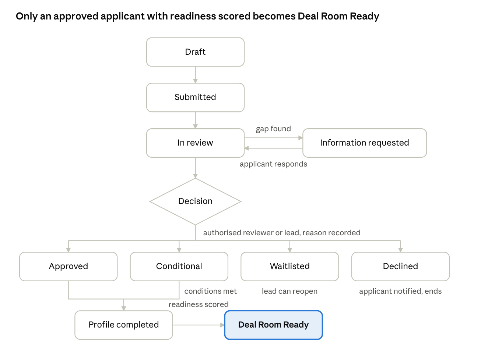
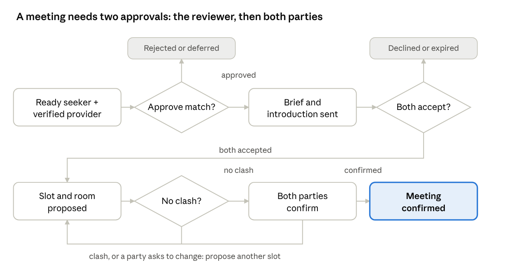
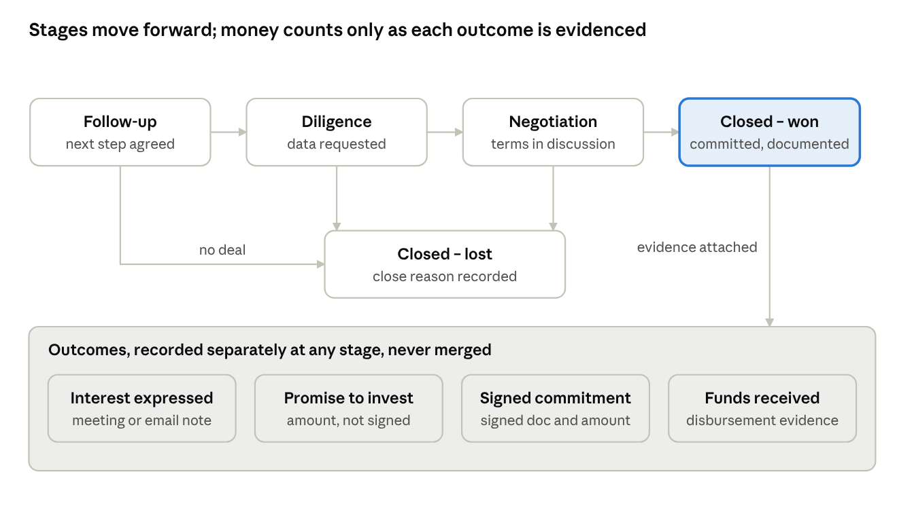

# ExcursiaConnect Deal Room — User Flows

Nov 6, 2026 · David Muia

## Flow 1 — Apply and get a decision

A capital seeker can be matched only after an authorised person approves the application and the seeker reaches Deal Room Ready. Use cases: CS-1 to CS-7, DR-1 to DR-3, DR-6, DL-5.

The review can loop through *Information requested* as many times as needed, and the application stays pending until the applicant responds or the lead applies the expiry policy. A decision always records who made it, when, and why. Approved and conditional applicants complete their matching profile; a conditional applicant must clear every condition before readiness can be set.

## Flow 2 — Finance provider onboarding

A provider can browse teasers only once it is Verified, which means its mandate has been reviewed, its KYC is complete and its NDA is signed. Use cases: FP-1 to FP-4, DR-4.

1. **Apply.** The provider opens the invitation link or the public page, signs in with a one-time code, and chooses *Finance provider* and its type (investor, fund, DFI, bank, buyer, distributor).
2. **Describe the mandate.** It enters sectors, countries, stages, the ticket range with currency, instruments and exclusions, then names a decision-maker. Missing advisory fields are flagged, but the provider can still submit.
3. **Submit.** The system issues a reference number (`CA3-FP-…`), sends an email and SMS, and adds the record to the review queue.
4. **Upload KYC.** The provider uploads registration documents, beneficial owners and the signatory's ID. Status: *Verification pending*.
5. **Sign the NDA.** The provider signs in-app (typed name, title, timestamp, version) or uploads a signed PDF. One NDA covers every opportunity in the event.
6. **Reviewer checks.** The reviewer checks the mandate against the form, ticks off each KYC item, enters the sanctions screening result and confirms the decision-maker (DR-4). Any gap triggers *Information requested*, which goes back to step 4.
7. **Verified.** The decision is recorded and the provider is notified. The Deal Room directory of teasers opens to them (FP-5).
8. **Later changes.** A material change to the mandate (ticket range, sectors, exclusions) sends the record for re-review, but the provider keeps its Verified status until a new decision is made.

## Flow 3 — From match to confirmed meeting

No meeting exists until a reviewer has approved the match and both parties have accepted the introduction. Use cases: DR-7 to DR-9, CS-8 to CS-10, FP-7 to FP-9, DO-2 to DO-4.

Rejected, declined and expired pairs are recorded and are not proposed again without a lead override. The system refuses any slot that clashes with a room, a table, either party's other meetings or their sessions, and it checks per-participant caps at the same time. Moving a confirmed meeting needs both parties to confirm again; moving it to another room in the same slot does not.

## Flow 4 — Summit day

On summit day, every confirmed meeting ends with a recorded attendance status and an outcome. Every outcome that has a next action becomes an opportunity with an owner. Use cases: DO-7 to DO-10, DL-9.

1. **Morning sync.** Operations opens the live board and the day's schedule exports. Rooms and tables are checked against the plan, and late changes from the previous evening are shown.
2. **Check-in.** The participant's ExcursiaConnect badge is scanned at the Deal Room desk. Their arrival is recorded against all their meetings for the day, and the board shows who is in the building.
3. **Before each slot.** At slot start minus 10 minutes, the board flags meetings where either party has not checked in. Operations can call or message them.
4. **Meeting starts.** The room door scan, or a tap on the board, marks the meeting *In progress*. If a party is more than 10 minutes late, operations marks a no-show for that party (the threshold is set by the lead).
5. **No-show refill.** The freed slot is offered to the next *Ready to schedule* match for the participant who did show up. That match must still be accepted by its other party.
6. **Outcome capture.** When the meeting ends, operations or the reviewer present records the status (held, cancelled, rescheduled, no-show), the outcome (positive, follow-up needed, not a fit), the next action, owner, due date and notes. Notes can be marked sensitive.
7. **Handover.** If an outcome has a next action, it creates an opportunity in the *Follow-up* stage and assigns the owner. The owner is notified.
8. **End of day.** At 19:00 the daily performance report goes to the lead. Operations fixes any meetings still missing an outcome before the report is regenerated.

## Flow 5 — Opportunity after the summit

Each opportunity moves through its stages with one owner and a next-action date, while interest, promise, commitment and funds received are recorded as separate outcomes with evidence. Use cases: DL-10, DL-12, CS-12, FP-10.

An open opportunity can close as lost from any stage, with a reason. Overdue next actions are flagged to the owner and the lead, and the lead marks every open opportunity as reviewed each month until 18 September 2027. Reports count the value promised, committed and received at the stage where it is evidenced.

## Flow 6 — Consent and document access

A document leaves the seeker's file only after the seeker has given consent for a named provider, and every opening is logged where the seeker can see it. Use cases: CS-8, CS-11, DR-9, FP-7.

1. **Upload.** The seeker uploads documents during the application. Each document is tagged with its type and date and starts as *Not shared*.
2. **Teaser.** The seeker completes the teaser and decides whether to show the organisation name or stay anonymous until an introduction. A reviewer approves the teaser.
3. **Introduction drafted.** The reviewer proposes what to share with a specific provider: teaser only, or teaser plus selected documents.
4. **Consent screen.** The seeker sees the provider's name, the brief and the list of proposed items. They tick which items to allow, then accept or decline. Their consent is stored with the time and version.
5. **Provider views.** After both parties accept, the provider sees the full profile and the consented documents. Previews are watermarked with the viewer's name, and download is allowed only where the seeker permitted it.
6. **Logged.** Each view and download is written to DocumentAccess and appears in the seeker's access log.
7. **Withdraw.** The seeker can withdraw consent per item at any time. Access stops immediately, the log keeps what was already opened, and the reviewer is notified.

## Flow 7 — Service interruption and recovery

During an outage, meetings carry on from printed schedules and offline capture. When the service returns, the records sync once, without duplicates **[Bouer UC-16]**. Use cases: DO-11, DA-7.

1. **Prepared the evening before.** Operations exports the next day's schedules per room and per participant as PDF and prints one set per room and one for the desk. The app caches the day's schedule on every operations device.
2. **Outage detected.** The app shows *Offline* and switches to the cached schedule. Algotech's alert fires and the on-call engineer starts the incident.
3. **Keep running.** Rooms follow the printed schedule. Operations records attendance and outcomes in the app's offline mode, where each record gets a client-generated ID. If a device is lost, the paper outcome sheet is the fallback.
4. **Changes during the outage.** No new meetings are booked. Reschedules are written on the printed schedule and entered once service returns.
5. **Service restored.** Devices sync their queued records, and the server deduplicates on the client-generated ID. Conflicts (the same meeting recorded on two devices) go to the lead to resolve and are never silently overwritten.
6. **Paper entry.** Authorised staff enter outcomes from the paper sheets. The system warns if a meeting already has an outcome.
7. **Close the incident.** Algotech sends the lead an incident report covering duration, cause, records synced and conflicts resolved. The daily report is regenerated.
