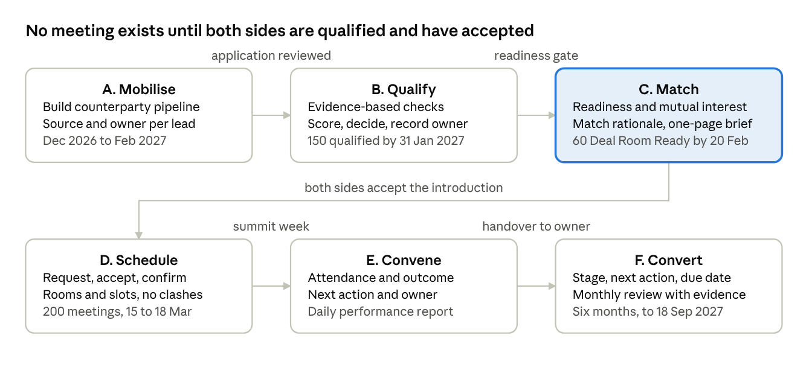

# Deal Room Research — What a Summit Deal Room Should Entail

Nov 6, 2026 · David Muia

## Summary

A summit deal room is a curated, consent-gated marketplace: it qualifies capital seekers and finance providers before the event, matches them only when both sides are ready, runs timed 1:1 meetings during the summit, and tracks every introduction to an evidenced outcome for months afterwards. The Bouer PRD for Connected Africa 3.0 (Oxygen as vendor) describes exactly this shape, and the reference it points to ([AfCEN Deal Room](https://dealrooms.africacen.org/)) adds the one thing the PRD under-specifies: evidence-linked readiness scoring and tiered information release under NDA.

Six things every credible deal room entails, in order of how much they decide success:

1. **Curation on both sides.** Investors are verified (mandate, KYC/AML, NDA); seekers are assessed against written criteria with evidence. Volume is not the goal: [a curated summit of 100 pre-qualified founders beats a fair of 1,000 unfiltered ones](https://www.converve.com/?p=32444).
2. **A readiness gate before any match.** AfCEN scores bankability, technical readiness and E&S on 0–100, each score tied to a source document and signed by a named person. AIF reports [95% of 2025 boardroom projects were investment-ready, up from 81%](https://southernafricantimes.com/?p=40737) and treats that as the headline metric.
3. **Request-and-accept introductions**, never auto-booking; both parties confirm before a meeting exists.
4. **Scheduling that survives contact with reality**: slots, rooms, caps per investor, no-shows, mid-event rebooking.
5. **Tiered confidentiality**: public teaser, full file for cleared investors, documents released only with a recorded approval, and an audit log of who opened what.
6. **Conversion tracking after the summit** with distinct outcome stages (interest, commitment, signed, funds received) and a named owner per deal.

For ExcursiaConnect this is a natural Phase 3+ module: it reuses registration, categories, badges, zones, room scheduling and the attendee directory, and adds qualification, matching, consent and a deal pipeline.

## Reference models

Five African deal rooms and one vendor category set the bar. The AfCEN site Bouer linked is the closest match to its PRD; AIF is the most mature on post-event tracking; AFS Forum is the longest-running at SME scale.

| Model | Run by / for | Scale and numbers | What it does well | Source |
| --- | --- | --- | --- | --- |
| [AfCEN Deal Room](https://dealrooms.africacen.org/) | Africa Climate and Energy Nexus, with WAIIS 2026 | 27 listed projects seeking USD 3,094m; Digital 12, Agribusiness 9, Minerals 4, Energy 2 | Five-step process (comes in, prepared, assessed, meets investors, followed through); 0–100 scores per criterion linked to a source document and confirmed by a named person; one NDA covers all projects; public teaser / full file / documents-on-approval tiers; audit log of who opened what; EN/FR | dealrooms.africacen.org |
| [Africa Investment Forum boardrooms](https://www.deik.org.tr/uploads/ek-aifmarketdaysbrochure.pdf) | AfDB and 8 founding partners | 2025 Market Days: 39 projects, 41 boardrooms, USD 15.3bn commitments, 2,000+ delegates; 2024: 37 projects, USD 29.2bn interest | Six-stage pipeline: origination (teaser, exploratory calls, NDA) → screening (bankability, KYC/IDD) → investor blast survey → matchmaking → boardroom sessions → Deal Tracker that monitors conversion of interest to financial close, plus a deal gallery for projects not in boardrooms | AIF brochure; [Southern African Times](https://southernafricantimes.com/?p=40737); [Guardian NG](https://guardian.ng/business-services/global-investors-african-leaders-meet-to-negotiate-billion-dollar-projects/) |
| [AFS Forum Agribusiness Deal Room](https://agrf.org/dealroom/for-smes/) | AGRA, at the Africa Food Systems Forum since 2018 | 2020 edition on b2match: 2,261 participants, 417 SMEs, 168 capital providers, 131 reviewed deals; ticket range USD 100k–50m; 400+ companies matched since 2018 | Written SME qualification criteria (sector link, Africa-active, post-revenue, scale plan in 12–24 months, seeking debt/equity); Excel profile template; 2-minute video; separate tracks for SMEs, investors, governments, anchor buyers; post-forum monitoring | agrf.org; [b2match stats](https://agrf-agribusiness-dealroom-2020.b2match.io); [AGRA](https://agra.org/?p=8215) |
| [Africa CEO Forum Investment DealRoom](https://www.theafricaceoforum.com/en/investment-dealroom/) | Jeune Afrique Media Group with Asoko Insight | 2019: 30 pre-qualified companies, ~USD 700m sought, 1:1 private meetings with PE firms | Small, pre-qualified cohort; data partner does the screening; the deal room is a programme inside a 1,500-person forum | theafricaceoforum.com |
| [EABC East Africa CEO & Investment Forum 2026](https://eabc-online.com/b2b-b2g-matchmaking-consultant-eabc-east-africa-ceo-investment-forum-2026/) | East African Business Council, Nairobi 17–18 Sep 2026 | Consultant brief, no outcome figures yet | Shows the operating model Bouer is buying: investor universe mapped early, outreach pack by month 2, deal room "built around prepared opportunities and decision-makers", post-forum follow-up on priority leads | eabc-online.com |
| [Event matchmaking vendors](https://www.converve.com/event-networking-blog/best-matchmaking-platforms-investor-meetings) (Converve, b2match, Brella, Grip, Swapcard, InEvent, Jublia) | Software used by the above | Mid-size investor days run 300–2,000 meetings; Converve from about €3,400 per event | Six buying criteria: structured thesis-fit data model, curation and request-and-accept, meeting caps, scheduling depth, follow-up tracking, explainable rule-based matching with an audit trail | converve.com |

Two patterns recur. Every serious deal room separates *being listed* from *being met*: listing needs a reviewed profile, a meeting needs readiness plus mutual acceptance. And every one that reports results reports a funnel (listed → met → interest → commitment → close), which is why outcome stages must be distinct fields from day one.

## The deal room lifecycle

The Bouer PRD's workstreams A–F are the same six stages AfCEN and AIF run; the three gates between them are what the platform must enforce, not just record.

Qualification feeds matching only through the readiness gate; a match becomes a meeting only after both parties accept; and every meeting hands a named owner a deal record that is tracked for six months. The dates and targets are Bouer's from the PRD (section 2A and 6).

## What the platform must entail

Twenty-six capabilities, grouped by lifecycle stage. "PRD" marks what Bouer already asks for; "Add" marks what the reference models do that the PRD leaves implicit or out.

| Stage | Capability | In Bouer PRD? | Why it matters (reference) |
| --- | --- | --- | --- |
| Mobilise | Pipeline of counterparties with source, owner and type (investor, DFI, bank, buyer, distributor, sponsor) | PRD | AIF's origination stage starts with a teaser and a named sponsor; EABC maps the investor universe before outreach |
| Mobilise | Two application forms: capital seeker (business, funding ask, documents) and finance provider (mandate: sectors, geographies, stages, ticket size, instruments, exclusions) | PRD | Thesis fit needs structured fields, or matching is guesswork (Converve criterion 1) |
| Mobilise | Reference number on receipt, status visible to the applicant, request-for-information loop | PRD | — |
| Qualify | Written criteria per counterparty type, stored as a rubric with weightings | Add (PRD says "agreed criteria", not how they are held) | AgriPitch weights 30/30/20/15/5; AFS publishes sector, country and stage criteria up front |
| Qualify | Evidence-linked scoring: each score points to the document it rests on and the reviewer who confirmed it | Add | AfCEN ties every 0–100 score to a source document and a named person |
| Qualify | Four-way decision (approve, conditional, waitlist, decline) with reason, decider and timestamp | PRD | — |
| Qualify | Investor verification: mandate, KYC/AML pack, decision-maker named, NDA signed once | Partly (PRD has approval, not KYC or NDA) | AfCEN and AIF both gate investor access on KYC/IDD plus an NDA |
| Qualify | Readiness status distinct from approval (approved to participate vs Deal Room Ready) | PRD (60 "Deal Room Ready" target) | AIF's headline KPI is the share of projects that are investment-ready |
| Match | Match search across approved profiles on the agreed criteria, with the criteria each match meets shown | PRD | Explainable, rule-based matching with an audit trail (Converve criterion 6) |
| Match | Reviewer decision per proposed match (approve, reject, defer); the system never forces a match | PRD | — |
| Match | One-page brief per match and agenda, decision-maker confirmed on both sides | PRD (7A-D) | AIF boardrooms run on prepared briefs; EABC's brief asks for the same |
| Match | Introduction with a per-introduction choice of what is shared; both parties accept or decline; schedulable only on double acceptance | PRD | Request-and-accept, not auto-booking (Converve criterion 2) |
| Schedule | Meeting request → proposed slot → participant confirm → room or online link → confirmations and reminders | PRD | — |
| Schedule | Conflict checks on room, participant and time; capped meetings per investor and per seeker | Partly (conflicts yes; caps only as an admin "booking limit") | Caps stop the most-wanted investors absorbing every request (Converve criterion 3) |
| Schedule | Meeting rules set by an admin: duration, buffers, booking limits, deadlines, applied the same on web, Android and iOS | PRD (UC-14) | Converve's planner defaults: 20-minute meetings, 5-minute buffers, tables cap parallel meetings |
| Schedule | Mid-event reschedule, no-show handling, walk-in rebooking from a live schedule | Partly (reschedule and no-show recorded; rebooking flow not described) | "Ask vendors to demonstrate a mid-event reschedule, not a clean demo calendar" |
| Schedule | Schedule exports per room, per day and per participant; backup printed schedule for an outage | PRD (UC-16, final validation) | — |
| Convene | Attendance capture (held, cancelled, rescheduled, no-show) and outcome with next action and owner | PRD | — |
| Convene | Daily performance report during summit week | PRD (7A-E) | — |
| Convene | Sensitive notes visible only to authorised roles | PRD | — |
| Convert | Deal record per opportunity: stage, owner, next action, due date, evidence, close reason | PRD | AIF's Deal Tracker monitors conversion of interest into commitments through to financial close |
| Convert | Outcome taxonomy that separates interest, promise, signed commitment and funds received | PRD (UC-11) | Every forum that reports results reports a funnel; conflating stages inflates it |
| Convert | Overdue flags and a monthly review view | PRD | — |
| Cross-cutting | Information tiers: public teaser, full file for cleared investors, documents on recorded approval | Add (PRD has consent, UC-15, but not tiers) | AfCEN's four tiers plus an audit log of who opened what |
| Cross-cutting | Role-based access for seven roles; activity history on decisions, grants, meeting changes, deal updates | PRD | — |
| Cross-cutting | Reporting across mobilisation, qualification, matchmaking, meetings and conversion, with exports | PRD | Follow-up tracking and CRM-shaped export (Converve criterion 5) |

## Qualification and readiness

Qualification should be a scored rubric with evidence per criterion, held in the system, not a free-text reviewer note. The PRD asks for "consistent evidence-based checks for eligibility, decision-making authority, funding need or mandate, readiness and fit" (7A-C); the models below show how to make that concrete.

**Capital seekers.** A workable rubric combines AFS Forum's eligibility screen with AgriPitch-style weighted scoring and AfCEN's evidence link:

| Layer | Criteria | Model |
| --- | --- | --- |
| Eligibility (pass/fail) | Sector in scope for the mission; active in the target geography (or entering within 12–18 months); post-revenue with product and customers; a plan to scale in 12–24 months; seeking a named instrument (debt, equity, other); legally registered | [AFS Forum SME criteria](https://agrf.org/dealroom/for-smes/) |
| Scored (0–100 each, weighted) | Value proposition and innovation; business feasibility and traction; sustainability and scalability (incl. management depth); investment appeal by stage; professionalism of the submission | [AgriPitch weights 30 / 30 / 20 / 15 / 5](https://vc4a.com/afdb/youth-agripreneur-agripitch-competition/) |
| Readiness (0–100 each) | Bankability; technical readiness; environmental and social; each score linked to the document it rests on and confirmed by a named reviewer | [AfCEN](https://dealrooms.africacen.org/) (example project scored 74 / 69 / 71) |
| Fit flags | Decision-maker named and reachable; ticket size inside a plausible investor band; conflicts or exclusions | PRD 7A-C and 7A-D |

**Finance providers.** Verification rather than scoring: firm and mandate (sectors, geographies, stages, ticket range, instruments, exclusions), KYC/AML pack, one NDA covering all opportunities, and a named decision-maker. AfCEN reviews every registration before granting access; AIF runs KYC/IDD before boardroom allocation.

**Status model.** Keep three independent states on a seeker record so reports stay honest: application status (received, in review, info requested, decided), decision (approved, conditional, waitlisted, declined), and readiness (not ready, in preparation, Deal Room Ready). A conditional approval with outstanding actions should be visible as such on the match list, not hidden behind a single "approved".

**Evidence.** Store each uploaded document with type, date and the criteria it supports; the reviewer picks the document when entering a score. That gives the "evidence" column in Bouer's section 2A table for free and makes the 31 January checkpoint auditable.

## Matching, introductions and scheduling

Matching is a reviewer-run, rule-based search; scheduling is logistics with caps. Neither should be a black box, because the Deal Room lead will be asked why a match was or was not made.

**Matching rules**

- Match on structured fields both sides filled in: sector, geography, stage, ticket size, instrument, exclusions. Show the criteria each candidate meets and misses; a score is useful for ordering, the explanation is what gets approved.
- Only Deal Room Ready seekers and verified providers enter the search (PRD section 2: "only when both sides are qualified, ready and have confirmed interest").
- The reviewer decides per pair: approve, reject, defer. No automatic introductions, and the system never forces a match when nothing fits (UC-07).
- Each approved match carries a rationale, a one-page brief and the named decision-maker on each side (7A-D). AIF's boardrooms and EABC's brief both treat the brief as the unit of preparation.

**Introduction rules**

- The reviewer chooses what is shared in the introduction (teaser only, or teaser plus selected documents); confidential documents never travel without recorded consent (UC-08, UC-15).
- Both parties accept or decline; the match is schedulable only on double acceptance. A decline is recorded with an optional reason so the same pair is not re-proposed.

**Scheduling rules** (the PRD gives the flow; these are the parameters to fix at design sign-off by 20 Nov)

| Parameter | Suggested default | Basis |
| --- | --- | --- |
| Meeting length | 20 minutes | Converve planner default; 30 for lead-sponsor or DFI meetings |
| Buffer between meetings | 5 minutes | Converve planner default |
| Cap per investor per day | Set per investor at onboarding (e.g. 6–8); rebalance load before the summit | Caps stop the most-wanted investors absorbing every request |
| Cap per seeker | 3–5 across the week | Keeps briefs and follow-up manageable |
| Parallel capacity | Number of Deal Room tables or rooms per slot | Tables cap parallel conversations; 200 meetings over 4 days at 20+5 minutes is about 50 per day, so 7 rooms running 8 hours clear it with slack |
| Request-to-confirm deadline | 48 hours before the slot, then auto-expire and re-offer | Prevents dead holds on scarce investor time |
| No-show handling | Mark no-show, release the slot, offer to the next accepted match; two no-shows flag the participant to the lead | "Handle no-shows and on-site rebooking" is a buying criterion for matchmaking software |
| Mid-event change | Reschedule within the same day where both accept; room change does not require re-acceptance | PRD scheduling rule: changes must not disrupt confirmed meetings |

The 200-meeting target is modest against the vendor benchmark of 300–2,000 meetings for a mid-size investor day, so the risk is not scheduling volume but readiness: 60 Deal Room Ready opportunities at an average of 3.3 meetings each is what fills 200 slots.

## Confidentiality, consent and information tiers

Adopt AfCEN's four-tier model; it is the clearest statement of what Bouer's "users must only see information they are allowed to access" means in practice for a deal room.

| Tier | Who sees it | Gate | Logged |
| --- | --- | --- | --- |
| Public teaser | Anyone, once the opportunity is approved | Reviewer approval of the teaser text | No |
| Full project file | Verified investors who have cleared KYC/AML and signed the NDA | Investor verification + NDA on file | Yes: who opened what, when |
| Documents | Named investors on a specific opportunity | Recorded approval by the seeker (or the Deal Room lead on their behalf) per document or document set | Yes, per document |
| Sensitive meeting notes and deal stage | Deal Room lead, assigned owner, operations where needed | Role | Yes |

Rules that follow from this:

- One NDA per investor covering all opportunities (AfCEN) is simpler than one per introduction and is what Bouer's "confidentiality arrangements" (7A-E) should mean; record the signatory, date and version.
- Consent is given by the seeker per introduction (UC-15): the participant sees what will be shared and with whom before accepting. Withdrawal revokes future access and is logged; it does not un-send what was already opened.
- Unapproved applicants see nothing private (acceptance criterion); approved participants see their own record, their introductions and their meetings, never the wider list.
- The audit log is a product feature, not just a security control: AfCEN exposes "who opened what" because sponsors ask which investors engaged. Expose it to the seeker for their own file.
- Kenya's Data Protection Act 2019 applies to personal data of applicants and decision-makers (ExcursiaConnect already carries the registration and residency requirements); the Deal Room adds business-confidential data, which the NDA and tiering govern.
- Store documents with retention rules: the PRD's six-month conversion window plus whatever Bouer's agreement with participants states; AfCEN keeps its log itself and does not publish a retention period.

## Reporting and conversion tracking

Report the funnel and nothing softer. Bouer's acceptance criteria already demand that reports "distinguish applicants, approved participants, meetings, active opportunities, commitments and funding actually received"; the reference models show what to measure at each stage.

| Stage | Measures | Breakdowns | Model |
| --- | --- | --- | --- |
| Mobilisation | Leads by source and owner; applications started vs submitted; time to first review | Mission, counterparty type, country, sector | PRD 2A row 1 |
| Qualification | Applications in review, info requested, decided; approval mix (approved / conditional / waitlisted / declined); share Deal Room Ready; median days from submission to decision | Mission, type, reviewer | AIF reports share investment-ready as its headline (95% in 2025) |
| Matchmaking | Matches proposed, approved, introduced; acceptance rate by side; declines by reason | Sector, ticket band, investor type | Converve: explainable matching needs an audit trail |
| Meetings | Requested, confirmed, held, cancelled, rescheduled, no-show; meetings per investor and per seeker against caps; room utilisation per slot | Day, room, investor type | PRD 2A row 3; daily performance report (7A-E) |
| Conversion | Opportunities by stage; interest expressed, commitment promised, signed, funds received (four distinct outcomes); value sought vs committed; overdue actions; closes by reason | Owner, sector, month | AIF Deal Tracker: interest → commitment → financial close; UC-11's four outcomes |

Three practices from the models that the PRD should state explicitly:

1. **Count value at the stage it is evidenced.** AIF reports "investment interest" (USD 29.2bn in 2024) separately from "commitments" (USD 15.3bn in 2025); the number that matters to Bouer six months out is funds received, with the evidence document attached.
2. **Monthly review as a view, not a meeting note.** Each deal shows stage, owner, next action, due date and last-evidence date; the monthly review is the filtered list of overdue and stalled deals.
3. **Export shape.** The post-summit export should be one row per opportunity with every stage date, so Bouer can hand it to a CRM or a funder's reporting template without re-keying.

Targets to display against actuals on the lead's dashboard: 150 qualified by 31 Jan 2027, 60 Deal Room Ready by 20 Feb 2027, 200 meetings 15–18 Mar 2027, conversion tracked to 18 Sep 2027.

## Bouer PRD against the research

The PRD is sound on process and weak on three things: the schedule, the undefined inputs that design sign-off depends on, and the investor-side controls every reference model has. The requirements-confirmation milestone is today, 6 Nov 2026, so these are the points to raise now.

**Schedule risks**

| Risk | Evidence in the PRD | Consequence | Option to propose |
| --- | --- | --- | --- |
| Four weeks of build for three channels | Design approved 20 Nov; MVP (web + Android + iOS) complete 18 Dec | Store review and a December holiday period sit inside the testing window; iOS review alone can take days and reject once | Ship web first as the MVP, a single cross-platform codebase for the apps, and make the apps a January launch-gate item only for registration and application journeys |
| Mobilisation starts before the platform exists | Mobilise runs Dec 2026–Feb 2027; onboarding opens 11 Jan 2027 | Pipeline is captured in spreadsheets for six weeks | Add bulk import of leads and applications with source and owner, so nothing is re-keyed on 11 Jan |
| 150 qualified in 20 days | Onboarding opens 11 Jan; 150 qualified by 31 Jan | Reviewer throughput, not software, is the constraint: 150 decisions in 15 working days is 10 per day with evidence | Pre-register and pre-screen the pipeline in December; agree reviewer staffing and a review SLA |
| Overlapping windows | Qualification "rolling to 20 Feb"; matching 1–19 Feb; development freeze 19 Feb | Matching runs on an incomplete qualified pool while the last core features land | Freeze the matching rules and fields by 20 Nov (design sign-off), so only data, not logic, moves in February |
| Contingency after the freeze | 22–26 Feb reserved; operations prep 22 Feb–5 Mar | One week to absorb what store rejections or load tests find | Pull capacity testing and the service-interruption rehearsal into the January launch gate |

**Inputs the PRD leaves undefined** (all needed for 20 Nov design approval): the three missions and the mission/source taxonomy; qualification criteria and any weighting; matching criteria and the fields both forms must capture; room and venue capacity for 15–18 Mar; the "agreed channels" for notifications (email, SMS, push); who signs the NDA and on what terms; performance, availability, backup and recovery targets (left to Oxygen to propose); the backup schedule format for an outage.

**Gaps against the reference models**

- No investor verification step: approval exists (UC-04) but no KYC/AML pack, mandate check or NDA. AfCEN and AIF both gate access on these.
- No information tiers: UC-15 records consent, but the PRD does not define teaser vs full file vs documents, or an access log the seeker can see.
- No scoring rubric or evidence link: "agreed criteria" and "evidence" are named but not modelled.
- No caps per investor or per seeker; "booking limits" (UC-14) is the only hook.
- No explainability requirement for matches beyond "explains the criteria each match meets" (UC-07); keep it rule-based and logged.
- No definition of the daily summit performance report's contents.
- No retention or deletion rule for confidential documents after 18 Sep 2027.

**Questions for Oxygen to put to Bouer**

1. Which three missions, and does a counterparty belong to one mission or several?
2. Is the mobile app required for reviewers and operations too, or only for applicants and participants?
3. Will Bouer's team or the platform run investor KYC and the NDA, and who holds the signed copies?
4. What are the qualification criteria and weightings per counterparty type, and who signs off a score?
5. How many reviewers and Deal Room leads will work the queue in January, and what decision SLA is acceptable?
6. Which fields define a match (sector, geography, stage, ticket, instrument, exclusions), and are any mandatory?
7. How many rooms and tables are available per slot during 15–18 Mar, and are online meetings allowed?
8. What meeting length, buffer and per-investor cap does Bouer want, and may the team override a cap?
9. What counts as evidence for each of the four outcomes in UC-11 (interest, promise, signed commitment, funds received)?
10. Which notifications must be SMS versus email, and is push from the apps acceptable as the primary channel?
11. What data is exported to whom after the summit, and in what format?
12. Does the January launch gate require the iOS app in the App Store or is TestFlight or enterprise distribution acceptable?

## Fit with ExcursiaConnect

About 60% of the Bouer Deal Room is already specified in the ExcursiaConnect PRD; the rest is one new module, switched on per event, that sits on top of registration, rooms and the attendee directory.

| Bouer need | ExcursiaConnect today | Deal Room module adds |
| --- | --- | --- |
| Two application types with documents, reference number, status | Self-registration with custom fields per category and file upload; approval-mode tiers; delegate status lifecycle (OS-2, DE-1) | Application-specific statuses (info requested, conditional, waitlisted) and a review queue with assignment |
| Reviewer, lead, operations, admin roles | Organiser owner, staff, zone staff, platform admin with per-event scoping and audit log | Three Deal Room roles (reviewer, lead, operations) with reviewer-only and lead-only actions |
| Qualification with evidence and scores | Nothing | Rubric per counterparty type; scores linked to uploaded documents; readiness state |
| Investor mandate and verification | Organiser KYC pattern (business, KRA PIN, signatory, ID scan) at the organiser level | The same KYC pattern applied to a participant category, plus mandate fields and NDA record |
| Matching and introductions | Attendee directory (opt-in), public calendars, meeting booking with clash prevention (DE-18, DE-19, Phase 3) | Rule-based match search across profiles, reviewer approval per pair, introductions with double acceptance and per-introduction sharing choice |
| Scheduling with rooms, no double-booking | Rooms inside zones, sessions with clash rejection, agenda builder, .ics, reminders by email and SMS | Staff-scheduled 1:1 meeting type bound to a room and slot, caps per participant, request-to-confirm deadline, reschedule and no-show flow |
| Attendance and outcomes | Badge scan at room door; session attendance per day | Per-meeting outcome, next action and owner; sensitive notes by role |
| Post-summit deal tracking for six months | Nothing (events close after the last day) | Deal record with stage, owner, next action, due date, evidence, close reason; overdue flags; monthly review view |
| Information tiers and consent | Consent for profile sharing and confidential documents (UC-15 equivalent), role-based access | Teaser / full file / document tiers, NDA gate, per-document access log visible to the seeker |
| Reporting | Per-event dashboard, Excel/CSV exports, scheduled reports | Funnel across mobilisation, qualification, matching, meetings and conversion |
| Web plus Android and iOS | Mobile web for delegates; native staff scanning app; native delegate app is an explicit non-goal | A decision: either extend the staff app into a participant app, or offer Bouer web plus the staff app and negotiate the native requirement |

**Implications for the roadmap.** Meeting booking, the directory and chat are Phase 3 in the ExcursiaConnect plan; a Deal Room customer would pull them forward and give them a sharper, organiser-controlled form (reviewer-approved introductions rather than open booking). The new entities are small: Application, Assessment (score + evidence), Mandate, Match, Introduction, DealRoomMeeting, Opportunity, NDA, DocumentAccess.

**Commercial note.** AFS Forum runs on b2match and Converve prices from about €3,400 per event, so a Deal Room module priced as a per-event add-on on the rate card (licence uplift plus on-site Deal Room desk staffing) fits the existing commercial model and the "matchmaking switched on per event" pattern Karibu markets in Kenya.

**Conflict to resolve.** The ExcursiaConnect PRD lists a native delegate app as a non-goal; Bouer makes Android and iOS mandatory for the January launch gate. Decide before any proposal whether the staff app grows into a participant app (one Flutter codebase) or the offer is web-first.

## Sources

Pages opened on 6 Nov 2026. The Bouer document is the attached "Deal Room Product Requirements Document and Use Cases"; the ExcursiaConnect PRD and stakeholder use cases are the project docs.

- [AfCEN Deal Room](https://dealrooms.africacen.org/) — process, scoring, information tiers, listings
- [Africa Investment Forum Market Days brochure (via DEIK)](https://www.deik.org.tr/uploads/ek-aifmarketdaysbrochure.pdf) — six-stage pipeline and Deal Tracker
- [Southern African Times: AIF secures $15.3bn](https://southernafricantimes.com/?p=40737) — 2025 results, 95% investment-ready
- [Newsday: 2024 AIF attracts US$29.2bn](https://newsday.co.zw/business/article/200035982/2024-africa-investment-forum-attracts-us292-billion) — 2024 results
- [Guardian Nigeria: AIF Market Days 2022](https://guardian.ng/business-services/global-investors-african-leaders-meet-to-negotiate-billion-dollar-projects/) — deal gallery
- [AFS Forum Deal Room: for SMEs](https://agrf.org/dealroom/for-smes/) — qualification criteria and application
- [AGRF Agribusiness Dealroom 2020 on b2match](https://agrf-agribusiness-dealroom-2020.b2match.io) — participant counts
- [AGRA: fourth edition of the Deal Room](https://agra.org/?p=8215) — cumulative numbers
- [MSME Africa: AGRF Deal Room call](https://msmeafricaonline.com/?p=2064) — USD 100k–50m ticket range
- [AfDB AgriPitch on VC4A](https://vc4a.com/afdb/youth-agripreneur-agripitch-competition/) — weighted evaluation criteria
- [Africa CEO Forum Investment DealRoom](https://www.theafricaceoforum.com/en/investment-dealroom/) — 2019 cohort
- [EABC matchmaking consultant brief](https://eabc-online.com/b2b-b2g-matchmaking-consultant-eabc-east-africa-ceo-investment-forum-2026/) — operating model for a Nairobi deal room
- [Converve: 8 best matchmaking platforms for investor meetings](https://www.converve.com/event-networking-blog/best-matchmaking-platforms-investor-meetings) — six buying criteria, vendor comparison (vendor-authored)
- [Converve: founder–VC matching playbook](https://www.converve.com/?p=32444) — planner defaults (20-minute meetings, 5-minute buffers)
- [Karibu by Cara: B2B matchmaking for African conferences](https://www.karibu.africa.com/blog/b2b-matchmaking-software-for-african-conferences) — per-event matchmaking module pattern
